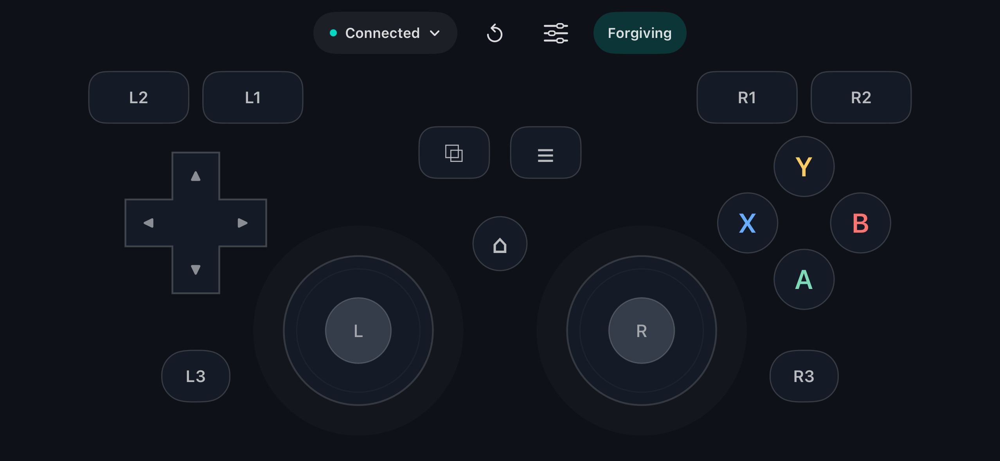
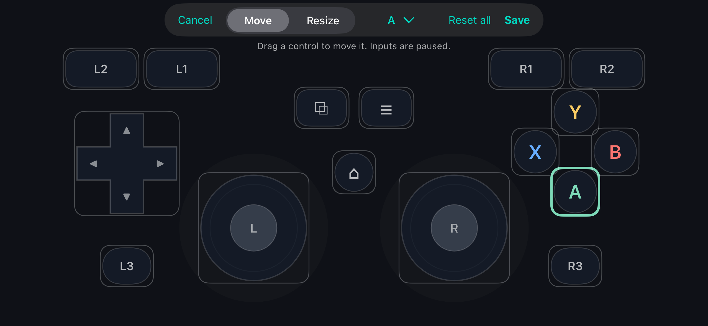

# iPhone Gamepad

[](https://github.com/Shuddown/iPhoneGamepad/actions/workflows/ci.yml)
[](LICENSE)

Turn an iPhone into a landscape Bluetooth gamepad for a Mac or iPad. The phone
sends Xbox-compatible controller reports directly to the host’s built-in
controller support. **Keep the app open on the iPhone; no companion receiver app
or virtual controller driver is needed.**



## Features

- Two independently tracked thumbsticks, eight-way D-pad, A/B/X/Y, shoulders,
  analog triggers, Select, Start, Home, and stick-click buttons.
- Multi-touch controls with neutral input on release, cancellation, or leaving
  active gameplay.
- A layout editor for moving and resizing controls, with Save, Cancel, and reset.
- Optional **Forgiving** input: full-screen nearest-target snapping, floating stick centers,
  and reduced jitter when sliding between face buttons.
- Optional touch feedback, landscape safe-area layout, and automatic screen-sleep prevention.
- Direct Bluetooth LE communication with the host.

## Compatibility and project status

This is an experimental native iPhone app, built from source and installed with
Xcode. There is no packaged app release yet.

| Component | Status |
|---|---|
| iPhone | Targets iOS 16+. Physical Bluetooth validation recorded on iPhone 15, iOS 27.0.1. |
| macOS host | Tested on macOS 27.0.1 with native Game Controller input and emulator gameplay. |
| iPad host | Native Xbox-compatible recognition and live buttons/sticks verified on iPadOS 27.0 after the UUID fix and a Bluetooth restart. Delta 1.7.6 lists the controller; gameplay verification pending. See [investigation](docs/IPAD-VALIDATION.md). |
| Windows host | Not tested. Windows Bluetooth LE HID support alone does not establish compatibility with this implementation. |
| Linux, Android, and other hosts | Not tested. |
| Layout editor / Forgiving mode | Builds and core logic tests pass; touch accuracy and comfort need broader hands-on testing. |

The app relies on **undocumented iOS HID service-publication behavior** and an
Xbox-compatible descriptor and device identity. The tested hardware/OS pair
establishes feasibility, not compatibility with every release or game. App Store
eligibility has not been established. Rumble commands are accepted but not
rendered, and gyro input is not implemented.

See the [physical-device evidence](docs/PROTOTYPE-VALIDATION.md) and
[layout/touch validation notes](docs/TOUCH-MODES-VALIDATION.md).

## Build and install

You need a Mac with Xcode and its iOS platform tools, XcodeGen, an Apple signing
team, and a physical iPhone with Developer Mode enabled. Development has been
validated with Xcode 27; CI builds with Xcode 26.6. The source uses Swift 6.
A simulator can build the UI but does not establish physical Bluetooth HID behavior.

```sh
git clone https://github.com/Shuddown/iPhoneGamepad.git
cd iPhoneGamepad
brew install xcodegen
xcodegen generate
open iPhoneGamepad.xcodeproj
```

In Xcode:

1. Select the **iPhoneGamepad** target and open **Signing & Capabilities**.
2. Select your development team and change the bundle identifier to one unique
   to you, for example `com.yourname.iphonegamepad`.
3. Select your connected physical iPhone and run the **iPhoneGamepad** scheme.
4. Allow Bluetooth access when prompted.

For repeatable personal builds, change `PRODUCT_BUNDLE_IDENTIFIER` and
`DEVELOPMENT_TEAM` in your local `project.yml` before generating the project.
Do not commit your signing details. The checked-in default bundle identifier is
retained for existing development installations; it is not a shared signing identity.
The Xcode project is generated and intentionally excluded from Git.

You can also build and install from the command line:

```sh
xcodebuild -project iPhoneGamepad.xcodeproj -scheme iPhoneGamepad \
  -configuration Debug -destination 'id=YOUR_IPHONE_UDID' \
  -derivedDataPath .build/device -allowProvisioningUpdates \
  DEVELOPMENT_TEAM=YOUR_TEAM_ID \
  PRODUCT_BUNDLE_IDENTIFIER=com.yourname.iphonegamepad build

xcrun devicectl device install app --device YOUR_IPHONE_UDID \
  .build/device/Build/Products/Debug-iphoneos/iPhoneGamepad.app
```

## Connect and play

1. Open **Connect & settings** on the iPhone.
2. Scan for your Mac or iPad and tap **Connect** beside it. Accept any system pairing prompts.
3. Repeat for another host if desired. **Connected** means that device subscribed
   to its own gamepad input report.
4. Return to the gamepad, then open a controller-enabled game or emulator on the
   host and select/configure its controller if needed.

Each device has its own **Connect / Disconnect** button. Disconnect removes
that device's controller service, so its native controller disappears while
other selected devices keep receiving input. Connect publishes a fresh service.
**Disconnect all** withdraws every controller and stops advertising. Selected
hosts are remembered across app launches; explicitly disconnected hosts stay off
until you connect them again.

This removes the **game controller**, rather than guaranteeing termination of
the shared Bluetooth link. Another host's vendor-defined HID collection or
Apple system services can keep the iPhone linked. Saved pairings are retained;
the app does not erase a host's Bluetooth history. Per-device removal was tested
on the iPad's native Game Controller API and Mac raw HID; other hosts and OS
versions remain unverified. See [connection research](docs/DISCONNECT.md).

**Use the iPhone app's connection flow.** The iPhone did not appear in the Mac's
normal Bluetooth device list during testing; that list is not required. The
same applies to the tested iPad. After upgrading an older profile, if the host
connects but detects no controller, turn Bluetooth off and on in the host’s
Settings, then reconnect from the iPhone app. This cleared stale identity data
on the tested iPad.
The Mac diagnostic tools in this repository are optional and can remain closed
while playing. USB is used for development installation, not controller input.

L2/R2 press fully at touch-down; drag down to reduce their analog value.
L3/R3 send stick-click button presses. Keep the app foreground while playing.

## Customize the controls

Tap the **sliders icon** beside Connect to open the layout editor. Choose
**Move** or **Resize**, then drag a control. The control menu also lets you select,
resize, or reset an individual control. **Save** persists the layout;
**Cancel** discards the draft, and **Reset all** restores the defaults in the draft.
Gameplay input is paused while editing.



Tap **Standard** to switch to **Forgiving**, and tap again to return. Forgiving
assigns background touches across the screen to the nearest gameplay target,
including above the shoulders, below L3/R3, and beside the pad. Each stick starts
at its initial touch position. Home, Start, and Select keep their precise targets.
The mode and saved layout persist across launches. Custom controls can overlap;
leave space between controls you need to press independently.

Read the [touch-mode behavior and research](docs/TOUCH-MODES.md) for the
target-selection rules, tradeoffs, and other interaction ideas. Layout inspiration is
credited in [layout references](docs/LAYOUT-REFERENCES.md).

## How it works

The app constructs a HID-over-GATT service using CoreBluetooth. Full canonical
Bluetooth service UUID strings preserve the tested iOS publication behavior;
characteristics and descriptors use short UUIDs for host recognition. A matching
Xbox BLE report descriptor, PnP compatibility identity, and input serializer let
macOS expose the device through its native Game Controller framework.

[Bluetooth architecture](docs/BLUETOOTH.md) explains the service tree,
connection setup, identity, and implementation limits.

| Directory | Responsibility |
|---|---|
| `iPhoneGamepad/App` | App entry point and preferences |
| `iPhoneGamepad/Controls` | Controls, touch state, layout geometry, and persistence |
| `iPhoneGamepad/Views` | Gameplay surface, editor, and connection settings |
| `iPhoneGamepad/Bluetooth` | Host discovery, gamepad publication, reports, and buffering |
| `Tests` | Executable core tests and selected physical-device evidence |
| `Tools` | Verification, formatting, and native Mac diagnostics |

## Verify and contribute

```sh
bash Tools/verify-gamepad.sh
bash Tools/format-swift.sh --check
```

The core tests cover report encoding, descriptor bit counts, input ownership,
release behavior, D-pad directions, deadzones, layout persistence/clamping,
forgiving target selection, floating sticks, and report buffering. They do not
replace physical Bluetooth or game testing.

Optional native Mac diagnostics:

```sh
.build/validation/GamepadMonitor
open .build/validation/GameControllerProbe.app
```

To format the source, run `bash Tools/format-swift.sh`.
See [CONTRIBUTING.md](CONTRIBUTING.md) for the unsigned build check and guidance
for changes to the Bluetooth profile. Bug reports and pull requests are welcome.

## License and attribution

[GNU AGPL v3](LICENSE), with the upstream project's AGPL-3.0-only licensing
retained. The Bluetooth implementation derives from
[jqssun/darwin-bt-remote](https://github.com/jqssun/darwin-bt-remote). Xbox BLE
descriptor code retains its MIT notices. Exact source revisions and credits are
in [ThirdParty/ORIGIN.md](ThirdParty/ORIGIN.md).

This is an independent project and is not affiliated with Apple or Microsoft.
The Xbox-compatible identity is used for host-driver compatibility.
The original emulator-tested prototype remains in commit `a6cf028`.
