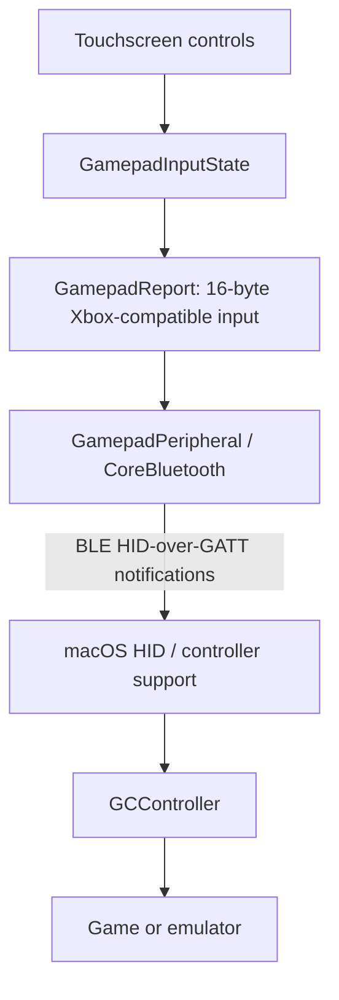

# Bluetooth architecture

The iPhone is the Bluetooth input device. macOS receives the reports through
its built-in HID and Game Controller support. The Mac diagnostic tools are
optional observers; they do not relay input or create a virtual controller.
USB is used for development installation and debugging.

## Input path

`GamepadTouchSurface` tracks independent fingers and resolves controls against
`GamepadLayout`. `GamepadInputState` combines held inputs. The view sends the
result through `GamepadPeripheral.sendGamepad`.

`GamepadReport` converts the app's logical values into the descriptor's wire
layout: four 16-bit stick fields, two 16-bit trigger slots containing 10-bit
values, a hat/padding byte, two button bytes, and a final Share/padding byte.
The input report ID is 1. Report IDs are associated with GATT characteristics
through Report Reference descriptors rather than prepended to these 16 bytes.

## Service publication

`GamepadHIDProfile` defines Bluetooth-assigned services and characteristic UUIDs.
`GamepadPeripheral` adds Battery (`180F`), Device Information (`180A`), and HID
(`1812`) in sequence, then advertises the HID service.

The HID service contains HID Information (`2A4A`), Report Map (`2A4B`), HID Control
Point (`2A4C`), and input/output Report (`2A4D`) characteristics. Report Reference
(`2908`) descriptors distinguish report IDs and directions. Input subscription
requires encryption. The system handles pairing and encryption keys.

The full canonical forms of the **service** UUIDs are deliberate. For example, HID uses
`00001812-0000-1000-8000-00805F9B34FB`. Upstream reports that the equivalent
16-bit short form is rejected as system-reserved on iOS. Publishing through the
full form is an observed workaround, not an Apple-documented HID-device API.
Characteristics and descriptors use the standard short forms, including PnP ID
`2A50`, Report `2A4D`, and Report Reference `2908`. Using full forms for those
initially left hosts with zero vendor/product IDs. Short forms plus a fresh
iPad Bluetooth connection produced native Xbox controller recognition and live
input. See [iPad validation](IPAD-VALIDATION.md).

## Connection setup

`GamepadHostDiscovery` uses a separate `CBCentralManager` to scan, connect, and
register for connection events. App startup starts that manager before the
peripheral manager. Their state callbacks are asynchronous; this is an intended
startup order, not a strict synchronization guarantee.

Use the in-app connection flow. The Mac's normal Bluetooth list did not show
the iPhone during the recorded tests. A successful scan or central connection
is distinct from the host subscribing to the gamepad's input characteristic.
The UI's Connected status uses the input-report subscriber set.

The connection UI offers per-device **Connect** and **Disconnect**. Disconnect
sends neutral input, removes the selected host's HID service, discards its queued
reports, and cancels the app's central-role connection request. Reconnect
publishes a fresh service for that host. Object identity checks ignore obsolete
service-publication callbacks. Other selected hosts remain active.
**Disconnect all** additionally stops advertising, withdraws all services, and
releases the peripheral manager. Reopening settings does not implicitly restart
a stopped controller. Explicit selections are persisted between app launches.

This is stronger than just `cancelPeripheralConnection`, which only cancels the
app's central-role connection, or `stopAdvertising`, which only stops advertising.
iOS shares its GATT database and Bluetooth radio across apps and system services.
The app can withdraw its own gamepad, but cannot force a host to erase saved
pairings or terminate unrelated Apple Bluetooth connections. See the
[disconnect research and hardware results](DISCONNECT.md).

## Controller identity

The generic prototype delivered raw HID input but not working native Game
Controller values. The current profile pairs an Xbox Series X BLE descriptor
with PnP identity `045E:0B13` (USB vendor-ID source) and a matching packet encoder.
That combination produced native `GCController` events on the tested Mac.
Manufacturer/model text still identifies the app as iPhone Gamepad.

This is a compatibility identity, not Microsoft hardware or a certification.
The descriptor's MIT notices and exact upstream revisions are in
[ThirdParty/ORIGIN.md](../ThirdParty/ORIGIN.md). Do not change the identity,
descriptor, or packet layout independently and assume compatibility is preserved.
Output report 3 accepts compatible rumble writes; force feedback is not rendered.

## Reports, recovery, and releases

A newly subscribed host receives the cached input report. CoreBluetooth
`updateValue` delivers subsequent notifications. If its queue is full,
`GamepadReportBuffer` retains the latest pending state per characteristic and
resumes when CoreBluetooth reports readiness. Very short press/release pairs
can be coalesced under congestion; the implementation promises no latency bound.

Each selected host gets a separate HID service instance. The dynamic Report Map
read returns the Xbox descriptor to that service's owner and a vendor-defined
16-byte input collection to other hosts. Notifications target only the owner.
Disconnect removes that instance with `CBPeripheralManager.remove(_:)`;
reconnecting creates fresh characteristics so delayed callbacks cannot revive
the old controller. Other hosts' services and notifications remain active.

The service database is shared across all connected hosts. Host-specific Report
Maps are an experimental interoperability technique, validated on the listed
physical devices, rather than a portable Bluetooth guarantee. Service removal
withdraws the controller, but does not promise to terminate the shared physical
Bluetooth link. See [per-device research and evidence](DISCONNECT.md).

The app releases logical inputs and sends a neutral report when leaving active
use, opening settings or the editor, changing touch mode, or resetting controls.
Keep the app foreground during gameplay. Declared Bluetooth background modes
are not a promise of unattended background controller operation.

## API and portability boundaries

Android's `BluetoothHidDevice` is a dedicated public HID-device API using the
Bluetooth Classic profile path. This app instead constructs BLE HOGP using
CoreBluetooth's general GATT publication APIs. Apple's `GCVirtualController`
provides on-screen input inside an app; it does not publish this Bluetooth device.

Windows includes BLE HID support, but discovery, pairing, native controller
binding, and game compatibility for this iPhone implementation are untested.
Other hosts and iOS releases also require physical validation. See the
[prototype evidence](PROTOTYPE-VALIDATION.md) and the README's compatibility table.

## References

- [Bluetooth SIG: HID over GATT Profile](https://www.bluetooth.com/specifications/specs/hid-over-gatt-profile-hogp/)
- [Apple: peripheral-role tasks](https://developer.apple.com/library/archive/documentation/NetworkingInternetWeb/Conceptual/CoreBluetooth_concepts/PerformingCommonPeripheralRoleTasks/PerformingCommonPeripheralRoleTasks.html)
- [Apple: canceling a local connection](https://developer.apple.com/documentation/corebluetooth/cbcentralmanager/cancelperipheralconnection(_:))
- [Apple: connection-event registration](https://developer.apple.com/documentation/corebluetooth/cbcentralmanager/registerforconnectionevents%28options%3A%29)
- [Android: BluetoothHidDevice](https://developer.android.com/reference/android/bluetooth/BluetoothHidDevice)
- [Microsoft: Windows Bluetooth profiles](https://learn.microsoft.com/en-us/windows-hardware/drivers/bluetooth/general-bluetooth-support-in-windows)
- [Original iOS publication constraints](https://github.com/jqssun/darwin-bt-remote#development)
